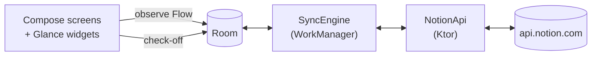

# Steady

An offline-first **Android** habit tracker for a habit database that lives in **Notion**.

Check habits off each day, and see streaks, a month, a year and completion rates, all with two-way
sync to your own Notion workspace. Built natively in Kotlin with Jetpack Compose.

> **Status: v1 is feature-complete and in release preparation (milestone M14).**
> The signed release build runs on a real phone against a real Notion database
> ([ADR-144](docs/decisions.md)). It is **not published**: whether v1 goes to a public Play listing
> or stays private is an open decision ([ADR-139](docs/decisions.md)).

---

## What it does

| Screen | What you get |
| --- | --- |
| **Week** (the landing tab) | The current week, one row of day pills per habit, today ringed. **Tap to check off or undo.** Pull down to sync. |
| **Month** | One dot grid per habit for the month, with a count. |
| **Year** | A habit's year as a dot grid, with its completion rate. |
| **Stats** | Per habit: year overview, completed days, completion rate, current and best streak, monthly completions chart. Plus **daily averages** of any Notion number properties you choose. |
| **Settings** | Connection status, **Notion sync** (status, sync now, errors, replace token, edit mapping, disconnect), **Your habits** (order and colour, app-local), **About** (data statement, licences, version). |
| **Home screen widgets** | *Habit grid*: a year of one habit as dots. *Number trend*: one number's last 30 days as a line. |

Every habit is daily. A streak breaks on any missed day, and the completion rate is completions ÷
days since the habit's first day. The app is **dark-theme only** in v1.

---

## Your Notion database

Steady reads one database shape, which is how its owner's tracker is built
([`docs/notion-schema.md`](docs/notion-schema.md)):

```
Habits (database)
├── page: 2026-08-19   Date ▸ 2026-08-19   📖 Read ☑   ✒️ Journal ☐   Weight 72.4
├── page: 2026-08-20   Date ▸ 2026-08-20   📖 Read ☐   ✒️ Journal ☑   Weight 72.1
└── …
```

- **One page per day**, with a **date** property identifying the day.
- **Each habit is a checkbox property.** The property's name is the habit's name, and a leading emoji
  becomes its icon.
- **Optional number properties** (weight, sleep, anything) can be shown as averages and trends.
  They are read-only.

During setup you **map** your properties onto this model: which date is the day, which checkboxes are
habits, which numbers to average. Property names are never hardcoded, and the mapping is keyed on
Notion's property **IDs**, so renaming a column in Notion does not break sync.

⚠ **A database built another way** (one page per habit, or one page per habit-day, or two related
databases) will connect but will not map. Nothing in v1 detects that yet.

**Steady never changes your database's structure.** Adding, renaming or removing a habit is done in
Notion, and the app follows ([ADR-010](docs/decisions.md)). The only thing it writes is checkbox
values, creating a day's page if that day has none yet.

---

## Connecting

1. In Notion's developer portal, create a **personal access token** (it starts with `ntn_`).
2. **Share your habit database with that connection** from the database's own menu in Notion.
   Without this, Notion answers *not found* rather than *forbidden*. The app detects that case and
   tells you to share the database.
3. In Steady, paste the token, pick the database, and map its properties.

There is no account and no server of ours. **This build connects one workspace: its owner's.** Letting
other people connect their own workspaces properly would need Notion OAuth, and OAuth needs a client
secret that cannot be kept inside an APK. That means a token-exchange backend, which is a separate
project ([ADR-004](docs/decisions.md), `CLAUDE.md` §3.1).

---

## How it works



- **Room is the source of truth for the UI.** No screen and no ViewModel waits on the network to
  render.
- **A check-off succeeds immediately and locally**, online or not. The day is marked `PENDING_PUSH`
  and sent at the next sync. Writes are coalesced rather than sent per tap.
- **Sync runs in WorkManager**: every 15 minutes, and on demand (pull-to-refresh, or *Sync now*),
  with a network constraint and exponential backoff. It **pulls incrementally** (only pages edited since the last
  successful sync) and **pushes** pending days.
- **Conflicts resolve last-write-wins per day**, comparing the local edit time with Notion's
  last-edited time. If your local edit loses, the sync screen says so.
- **The mapping is validated before every sync.** A property that was renamed, retyped or deleted in
  Notion pauses sync with an actionable message; the app never writes a null over real data.
- **Sync is invisible until it fails.** A failure is a state on screen with a retry, never a crash or
  a modal. Requests go through a client-side throttle, and a 429's retry delay is honoured.
- **The Notion API version is pinned** to `2026-03-11`, the data-sources API
  ([`docs/notion-api.md`](docs/notion-api.md), ADR-037).

---

## Privacy and security

- **`api.notion.com` is the only host the app contacts.** No analytics, no crash reporting, no
  telemetry. `INTERNET` exists for Notion sync and nothing else; fonts are bundled, not fetched.
- Habit data is sent to **Notion**, at the user's instruction, and to nowhere else.
- **The token is encrypted with AES-256/GCM under a key held in the Android Keystore**, using the
  platform API directly rather than the deprecated `security-crypto` library (ADR-042). It leaves the
  device only as the `Authorization` header on a Notion request, and is never logged.
- **Disconnect** deletes the token, and optionally the local copy of your data. Nothing in Notion is
  ever deleted by the app.

---

## Tech stack

| Concern | Choice |
| --- | --- |
| Language | Kotlin 2.2 |
| UI | Jetpack Compose + Material 3; widgets in Jetpack Glance |
| Architecture | MVVM + unidirectional data flow, packaged by feature |
| DI | Hilt |
| Async | Coroutines, `Flow` / `StateFlow` |
| Local database | Room (KSP), schemas exported and migration-tested |
| Preferences | DataStore |
| Networking | Ktor Client (OkHttp engine) + kotlinx.serialization |
| Background work | WorkManager |
| Navigation | Navigation Compose, type-safe routes |
| Dates | `java.time`, behind an injected clock |
| Build | Gradle Kotlin DSL, version catalog, AGP 9.4 |
| Release | R8 with resource shrinking, a Baseline Profile |
| Quality | ktlint, detekt, Android Lint |

`minSdk 26` · `targetSdk`/`compileSdk 37` · application ID `com.cristianprincipi.habits` · version
`1.0.0 (1)`.

Every version is pinned in [`gradle/libs.versions.toml`](gradle/libs.versions.toml), resolved from a
live repository. **Kotlin, KSP and Ktor move together**: see that file's header before bumping any of
them.

---

## Building

You need Android Studio (its bundled JDK is fine) and the Android SDK with platform 37.

```bash
./gradlew assembleDebug            # build
./gradlew installDebug             # build + install on a connected device or emulator
./gradlew test                     # JVM unit tests
./gradlew ktlintCheck detekt lint test assembleDebug   # the gate every milestone passes
```

### Tests

- **JVM:** use cases (streaks, rates, week math), ViewModels against fake repositories, and the **sync
  engine against a fake Notion API**: first import, offline queue, conflicts, archived pages, renamed
  or removed properties, revoked token, 429 backoff, resume after a mid-sync kill. No test ever
  contacts the live API.
- **Instrumented** (`./gradlew connectedDebugAndroidTest`): Compose UI tests, including the three
  primary flows (check off a habit, connect to Notion, navigate the shell).

> ⚠ **`connectedDebugAndroidTest` uninstalls the app**, and a live Notion connection goes with it.
> Run it on an emulator, with any phone you care about unplugged.

### Release build

Release signing reads `keystore.properties`, which is gitignored. Copy
[`keystore.properties.template`](keystore.properties.template), which explains how to create a
keystore and why to back it up, and fill it in **yourself, outside any AI coding session**
(ADR-142). Then:

```bash
./gradlew assembleRelease          # signed, minified APK
./gradlew bundleRelease            # signed AAB for Play
```

Without `keystore.properties`, the release build is produced unsigned.

⚠ A release-signed build will not install over a debug build, or the other way round. Switching
means uninstalling, which disconnects Notion.

### Baseline Profile

The profile in `app/src/release/generated/` records the path the user repeats: cold start into Week,
a check-off, the tabs. Regenerate it after changing any of those, on the `Pixel_9` emulator with
**phones unplugged** (it uninstalls the app, and refuses to run unless the serial names an emulator):

```bash
ANDROID_SERIAL=emulator-5554 ./gradlew :app:generateBaselineProfile
```

On a OnePlus 12 it takes a cold start from **158 ms to 136 ms** ([ADR-144](docs/decisions.md)).

---

## Repository map

| Path | What it is |
| --- | --- |
| `app/` | The application, one module, packaged by feature (`feature/week`, `history`, `stats`, `notionsetup`, `syncstatus`, `widget`, …). |
| `baselineprofile/` | Test-only module that generates the Baseline Profile. Ships nothing. |
| [`CLAUDE.md`](CLAUDE.md) | The constitution: architecture, coding rules, guardrails. Read first. |
| [`Plan.md`](Plan.md) | Live state: current step, every milestone, session log. |
| [`docs/decisions.md`](docs/decisions.md) | Append-only architecture decision record (ADR-001 onward). |
| [`docs/design-spec.md`](docs/design-spec.md) | The UI spec extracted from the Figma Make prototype. |
| [`docs/tokens.md`](docs/tokens.md) | Design tokens ported from the prototype. |
| [`docs/notion-schema.md`](docs/notion-schema.md) | The real Notion database this app was built against. |
| [`docs/notion-api.md`](docs/notion-api.md) | Notion API facts confirmed from the live reference. |
| [`docs/attributions.md`](docs/attributions.md) | Every bundled third-party asset and its licence. |

---

## Not in v1

Deferred, not cancelled: schedules (weekdays, N× per week), reminders, onboarding, JSON export and
import, a light theme, and Notion OAuth for other people's workspaces.

Out of scope: accounts, a backend, social features, Wear OS, paid tiers.

---

## Credits

DM Sans and DM Mono (SIL Open Font License 1.1) and Lucide icons (ISC License). Full licence texts
ship inside the app. See [`docs/attributions.md`](docs/attributions.md).

Steady is not affiliated with or endorsed by Notion Labs, Inc.
