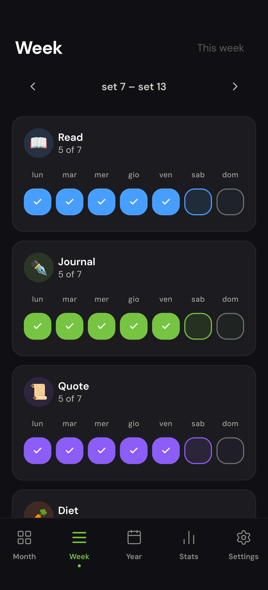
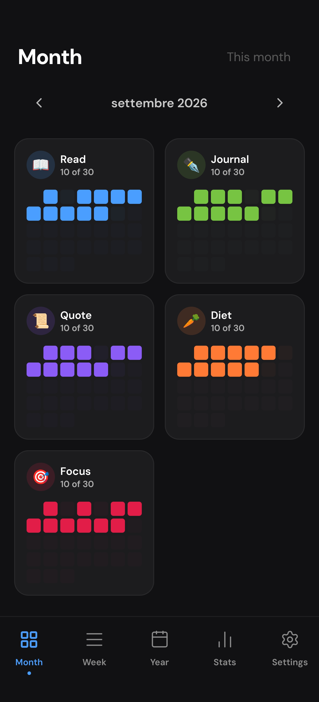
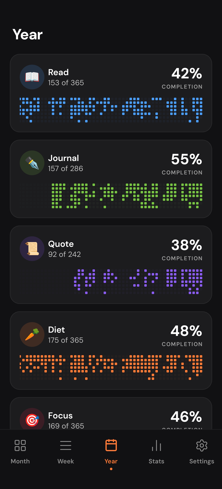
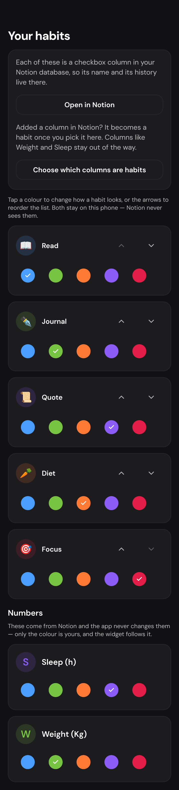
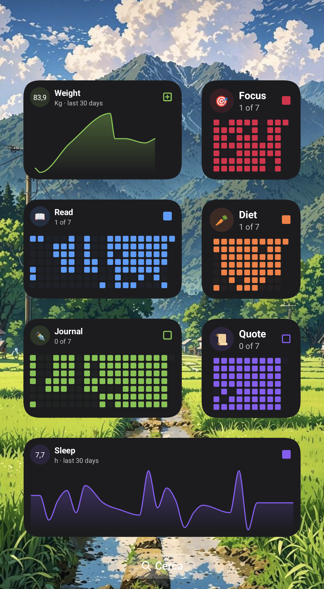
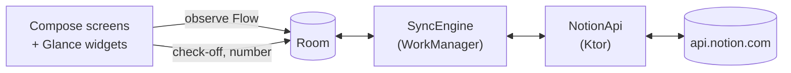

# Steady

**A habit tracker for Android that syncs with Notion**

[](LICENSE)
[](gradle/libs.versions.toml)
[](app/build.gradle.kts)

<picture>
  <source media="(prefers-color-scheme: dark)" srcset="docs/images/made-for-notion-white.png">
  
</picture>

Check your habits off each day, type in numbers such as weight or sleep, and see streaks, a month,
a year and completion rates. Your habits live in a Notion database of your own; Steady keeps a copy
on the phone so it works with no signal, and syncs both ways whenever it can reach Notion.

Steady is not on Google Play. Download the APK from
[Releases](https://github.com/CristianPrincipi/Steady-Habit-Tracker/releases/latest), or build it from source
as described under [Setup](#setup).

## Screenshots

| Week | Month | Year | Your habits | Widgets |
| :---: | :---: | :---: | :---: | :---: |
|  |  |  |  |  |

## Features

- **Week** is the landing tab: one row of day pills per habit, today ringed. Tap to check off, tap
  again to undo. Under the habits, each number you track has a row of daily values: tap a day to
  type its value, change it or clear it. Pull down to sync.
- **Month** and **Year** show each habit as a dot grid, with a count and a completion rate.
- **Stats** per habit: completed days, completion rate, current and best streak, and a monthly
  completions chart. Number properties you choose (weight, sleep, anything) are shown as daily
  averages over the last 30 days.
- **Home screen widgets**: *Habit grid*, a year of one habit as dots, with a square in the corner
  that checks today off without opening the app; and *Number trend*, one number's last 30 days as a
  line, with a square that opens today's value for typing.
- **Two-way Notion sync**, offline-first. A check-off or a typed number is saved on the phone
  immediately and sent to Notion afterwards; changes made in Notion are pulled down.
- **Property mapping**: you choose which date property is the day, which checkboxes are habits and
  which numbers to track. No property name is hardcoded.
- **Habit order and colour** are set in the app and stay on the phone.
- **Sync status** in Settings: last result, errors with a retry, *Sync now*, replace the token, edit
  the mapping, disconnect.
- **No telemetry.** `api.notion.com` is the only host the app contacts.

Every habit is daily. A streak breaks on any missed day, and the completion rate is completions
divided by days since the habit's first day. The app is dark-theme only and in English.

## Tech stack

| Concern | Choice |
| --- | --- |
| Language | Kotlin 2.2.10 |
| UI | Jetpack Compose (BOM 2026.08.00) + Material 3; widgets in Jetpack Glance 1.2.0 |
| Architecture | MVVM + unidirectional data flow, packaged by feature |
| DI | Hilt 2.60.1 |
| Async | Coroutines, `Flow` / `StateFlow` |
| Local database | Room 2.8.4 (KSP), schemas exported and migration-tested |
| Preferences | DataStore 1.2.1 |
| Navigation | Navigation Compose 2.10.0, type-safe routes |
| Background work | WorkManager 2.11.2 |
| Networking | Ktor Client 3.3.3 (OkHttp engine) + kotlinx.serialization |
| Dates | `java.time`, behind an injected clock |
| Build | Gradle 9.7.1 (Kotlin DSL, version catalog), Android Gradle Plugin 9.4.0 |
| Release | R8 with resource shrinking, a Baseline Profile |
| Quality | ktlint, detekt, Android Lint, Kover |

Every version is pinned in [`gradle/libs.versions.toml`](gradle/libs.versions.toml).

## Architecture



- **Room is the source of truth for the UI.** No screen and no ViewModel waits on the network to
  render.
- **A check-off succeeds immediately and locally**, online or not. The day is marked as pending and
  pushed at the next sync. A typed number is pending on its own, so sending it never re-sends the
  day's checkboxes.
- **Sync runs in WorkManager**: each time the app comes to the front, every 15 minutes, and on demand
  (pull-to-refresh or *Sync now*), with a network constraint and exponential backoff. One run at a
  time.
- **Pull is incremental** (only pages edited since the last successful sync). **Conflicts resolve
  last-write-wins**, per day for checkboxes and per value for numbers, and the sync screen says so
  when a local edit loses.
- **The mapping is validated before every sync.** A property that was retyped or deleted in Notion
  pauses sync with a message; the app never writes a null over real data.
- **Requests are throttled** to about three per second, and a `429` is retried after the delay Notion
  asks for.
- **The Notion API version is pinned** to `2026-03-11` (the data-sources API).
- **The token is encrypted with AES-256/GCM** under a key held in the Android Keystore, and stored as
  ciphertext in DataStore. It leaves the device only as the `Authorization` header on a request to
  Notion and is never logged.

```
app/src/main/java/com/cristianprincipi/habits/
├─ core/          designsystem, datetime, network (throttle, retry), ui, widget
├─ data/
│  ├─ local/      Room database, entities, DAOs, migrations
│  ├─ remote/notion/   the only package that touches the network: API, DTOs, mappers, token store
│  ├─ sync/       SyncEngine, SyncWorker, SyncScheduler, ConflictResolver
│  ├─ preferences/     DataStore: settings and the property mapping
│  └─ repository/
├─ domain/        models, repository interfaces, use cases (streaks, rates, toggles)
├─ feature/       week, history (month and year), stats, managehabits, notionsetup,
│                 syncstatus, settings, about, widget
└─ navigation/
baselineprofile/  test-only module that generates the Baseline Profile; ships nothing
```

## Requirements

- **Android Studio** recent enough to support Android Gradle Plugin 9.4.0
- **JDK 21** for the Gradle daemon (`gradle/gradle-daemon-jvm.properties`); Android Studio's bundled
  JDK works. The code itself is compiled for Java 17.
- **Android SDK Platform 37** (`compileSdk` and `targetSdk` are 37)
- A device or emulator running **Android 8.0 (API 26)** or newer (`minSdk` is 26)
- A **Notion** account

Gradle 9.7.1 comes with the wrapper; you do not need to install it.

## Setup

### Install the app

Either download `Steady-<version>.apk` from the
[latest release](https://github.com/CristianPrincipi/Steady-Habit-Tracker/releases/latest) and open it on your
phone (Android asks you to allow installs from your browser or file manager), or build it:

1. **Clone the repository.**

   ```bash
   git clone https://github.com/CristianPrincipi/Steady-Habit-Tracker.git
   ```

2. **Open it in Android Studio** and let Gradle sync. Android Studio writes `local.properties` with
   your SDK location; that file is gitignored.

3. **Build and run.**

   ```bash
   ./gradlew installDebug
   ```

   A debug build has the same package name as the APK from Releases but is signed with another key,
   so Android won't install one over the other. Uninstall the one on the phone first.

### Connect Notion

1. **Create a Notion token.** In Notion's developer portal, create a personal access token (Notion's
   current name for an internal integration token). It starts with `ntn_`, and Notion shows it only
   once, so copy it. The connection needs permission to read, update and insert content.

2. **Create the database.** Steady expects one page per day, with these properties:

   | Property | Type | Required |
   | --- | --- | --- |
   | The day (any name, for example `Date`) | Date | Yes |
   | One per habit (any name, for example `📖 Read`) | Checkbox | At least one |
   | Numbers to track (any name, for example `Weight`) | Number | No |

   Names are yours to choose, because you map them in the app. The full example database, with every
   property and option, is in [`docs/notion-setup.md`](docs/notion-setup.md).

3. **Connect the token to the database.** In Notion, open the database → `•••` → *Add connections*,
   and add your connection. A valid token cannot see a database until you do this.

4. **Paste the token in the app.** On first launch Steady asks for the token, lists the databases it
   can reach (or takes a pasted database link), and asks which columns are the day, the habits and
   the numbers. The token is entered in the app only. It is never read from `local.properties`, a
   Gradle property or the build.

### Other builds

```bash
./gradlew test                                          # JVM unit tests
./gradlew connectedDebugAndroidTest                     # instrumented tests
./gradlew ktlintCheck detekt lint test assembleDebug    # the full check
./gradlew assembleRelease                               # minified release build
```

`connectedDebugAndroidTest` uninstalls the app when it finishes, and your Notion connection goes
with it. Run it on an emulator.

A release build is signed only if `keystore.properties` exists; copy
[`keystore.properties.template`](keystore.properties.template) and fill it in. Without it the release
APK is produced unsigned and never falls back to the debug key.

## Troubleshooting

| What you see | What Notion answered | Fix |
| --- | --- | --- |
| "Notion wouldn't accept that token." | `401` | The token is mistyped, incomplete or revoked. Create a new one and paste it in *Settings → Notion sync*. |
| "That token isn't allowed to do this." | `403` | Give the connection permission to read, update and insert content. |
| "No database is shared with this connection yet." or an empty database list | `404` | The database is not shared with the connection. Open it in Notion → `•••` → *Add connections*. Notion answers *not found* here, not *forbidden*. |
| "Notion is busy or having trouble." | `429` or `5xx` | Usually nothing to do. The app waits for the delay Notion asks for and retries by itself; this message appears only if it is still failing after several attempts. |
| "Your database has changed since it was set up." | – | A mapped property was retyped or deleted. Fix it in Notion or re-map it in *Settings → Your habits*. |
| "Couldn't reach Notion." | – | No connection. Check-offs and numbers are kept on the phone and sent at the next sync. |
| The database is missing from the list | – | A database shared a moment ago can take a minute to appear. Paste its link instead. |

## Roadmap

Not implemented yet:

- Schedules (weekdays, N times per week); today every habit is daily
- Reminders
- Onboarding
- JSON export and import
- A light theme
- Translations (strings are externalised; only English ships)
- Notion OAuth, so other people can connect without creating a token. That needs a token-exchange
  backend, because an OAuth client secret cannot be kept inside an APK.
- Detecting a database built another way (see [`docs/notion-setup.md`](docs/notion-setup.md))

Out of scope: accounts, a backend of our own, social features, Wear OS, paid tiers.

## Contributing

Issues and pull requests are welcome. Before opening a pull request, run:

```bash
./gradlew ktlintCheck detekt lint test assembleDebug
```

Tests never contact the live Notion API; the sync engine is tested against a fake.

Steady is licensed under the GPL-3.0. By contributing you agree that your contribution is licensed
under the same terms, and anyone who distributes a modified version must release its source under
the GPL-3.0 as well.

Comments in the code cite design notes (`ADR-…` numbers and `M…` milestone markers) that are kept
outside this repository.

## License

Copyright (C) 2026 Cristian Principi

This program is free software: you can redistribute it and/or modify it under the terms of the GNU
General Public License as published by the Free Software Foundation, version 3.

This program is distributed in the hope that it will be useful, but WITHOUT ANY WARRANTY; without
even the implied warranty of MERCHANTABILITY or FITNESS FOR A PARTICULAR PURPOSE. See the
[GNU General Public License](LICENSE) for more details.

Bundled third-party assets keep their own licences: see
[`docs/attributions.md`](docs/attributions.md). The "Made for Notion" badge is a Notion asset used
under Notion's brand guidelines and is not covered by this licence.

## Acknowledgements

- [DM Sans](https://github.com/googlefonts/dm-fonts) and
  [DM Mono](https://github.com/googlefonts/dm-mono) (SIL Open Font License 1.1)
- [Lucide](https://github.com/lucide-icons/lucide) icons (ISC License)
- Built with [Claude Code](https://claude.com/claude-code).

---

Steady is an independent project and is not affiliated with, endorsed by, or sponsored by Notion Labs, Inc. Notion is a trademark of Notion Labs, Inc.
